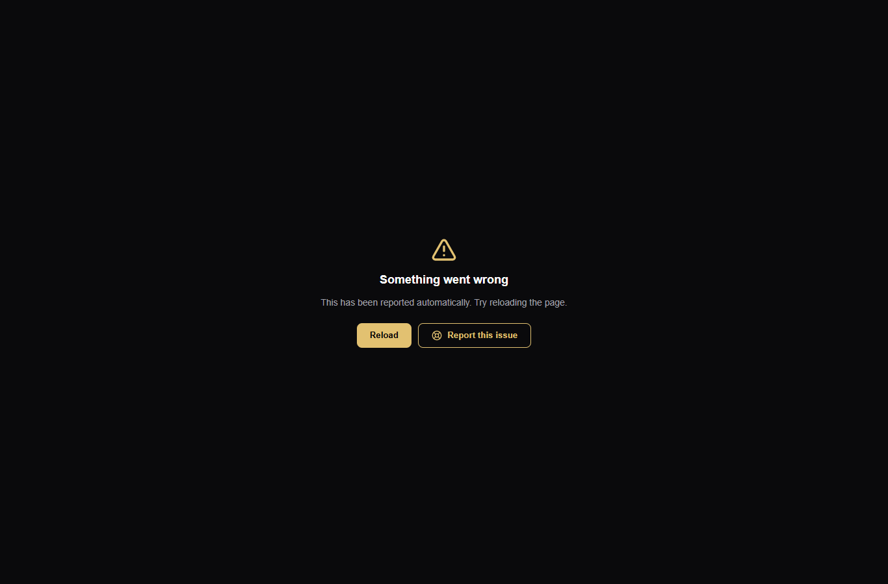
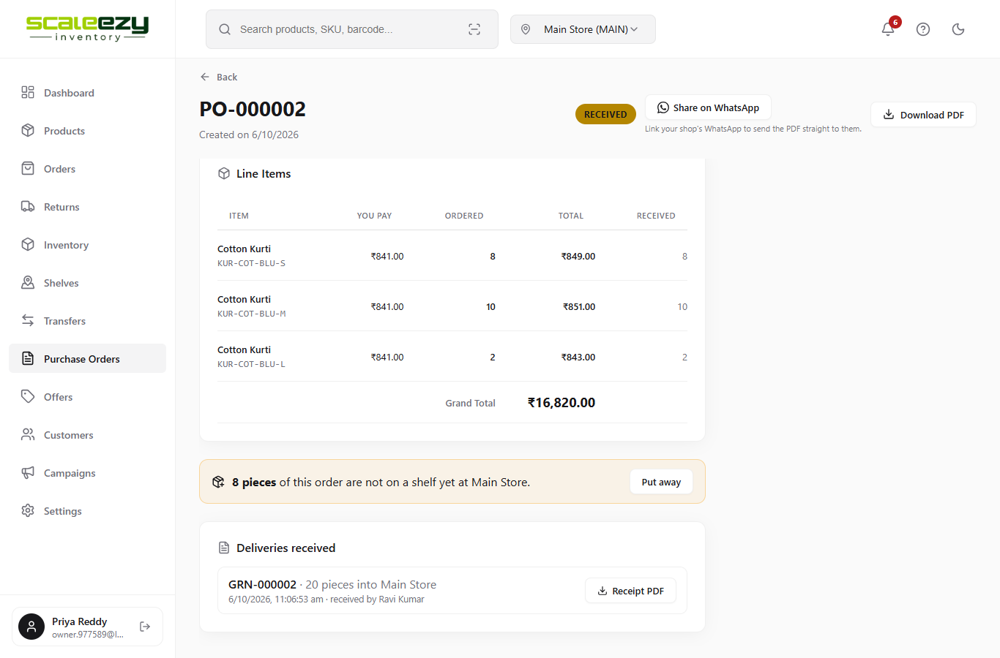
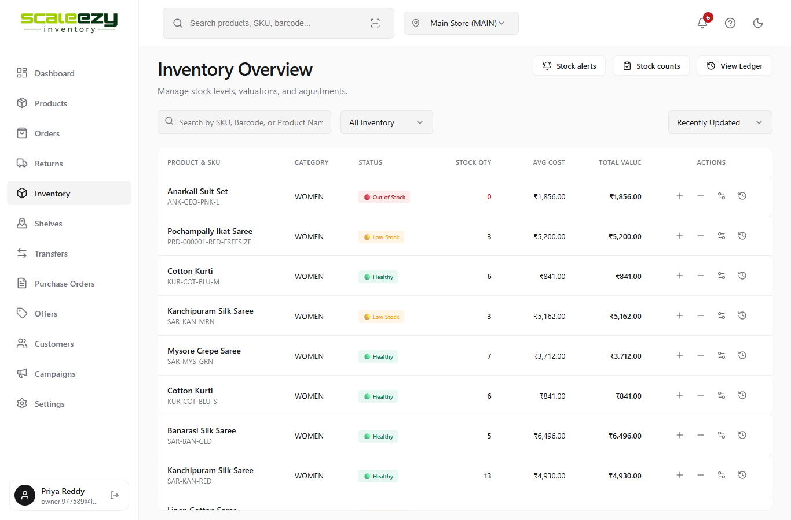
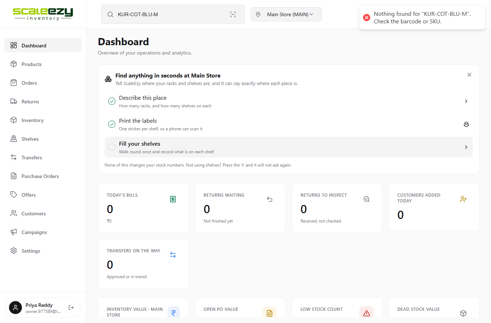
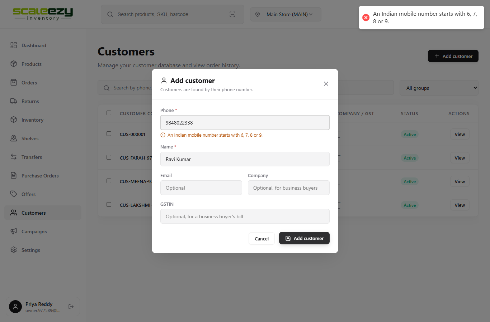
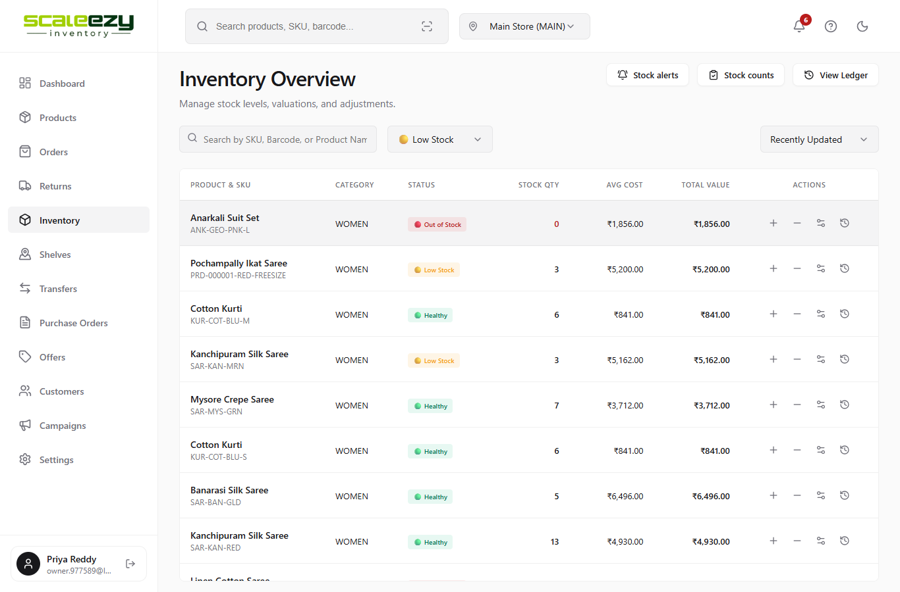
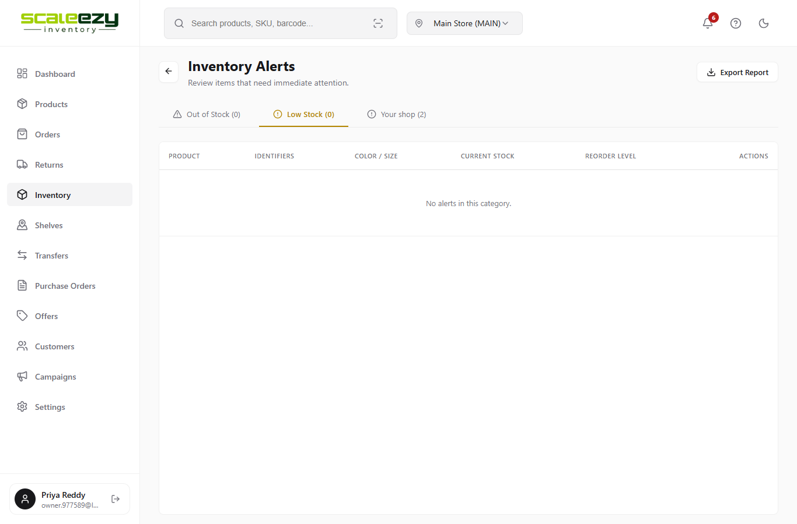
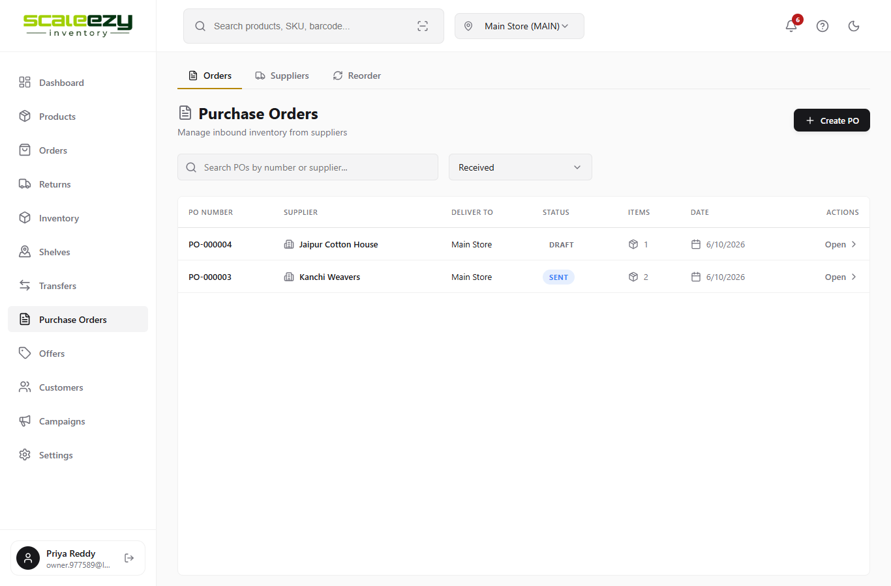
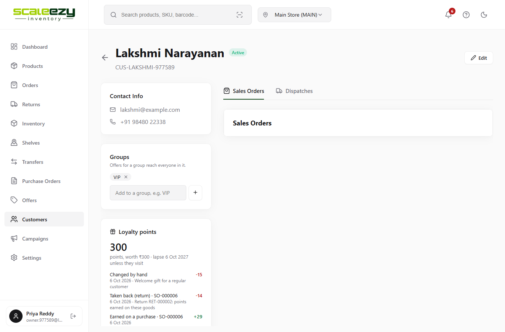
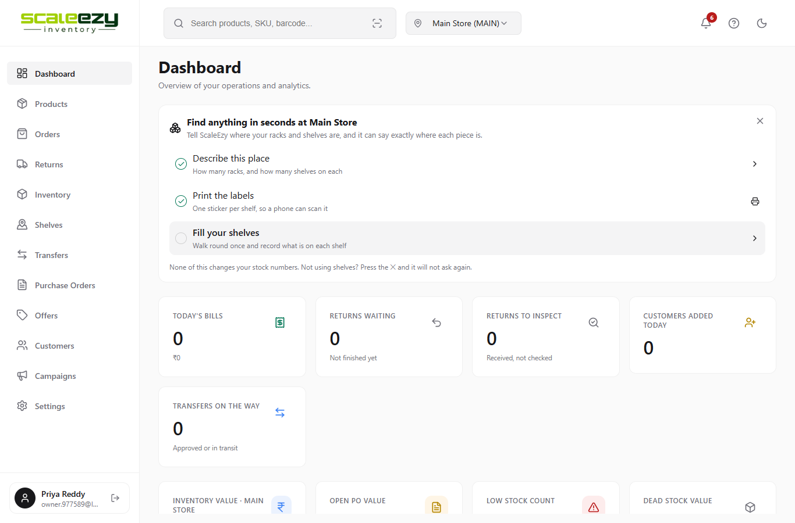

# Inventory - Bug Report

## BUG-01: Product page crashes when opened

**Steps:**

1. Go to Products.
2. Click any product (for example Kota Doria Saree).

**Description:** The product page should open with its details, but the screen shows "Something went wrong" and nothing else. No product can be opened.

## BUG-02: Purchase order line totals are wrong

**Steps:**

1. Go to Purchase Orders.
2. Open PO-000002.

**Description:** Total for 8 pieces at ₹841 should be ₹6,728, but it shows ₹849. Every line adds the price and quantity instead of multiplying them. The Grand Total (₹16,820) does not match the lines.

## BUG-03: Inventory Total Value shows the price of one piece

**Steps:**

1. Go to Inventory.
2. See the Total Value column for Kanchipuram Silk Saree (SAR-KAN-RED, 13 in stock).

**Description:** Total Value should be ₹64,090 (13 x ₹4,930), but it shows ₹4,930. Every row shows the cost of one piece. Sold-out items show a value even with 0 stock.

## BUG-04: Top search finds nothing

**Steps:**

1. Type KUR-COT-BLU-M in the search box at the top.
2. Press Enter.

**Description:** It should open the Cotton Kurti product, but it shows "Nothing found". Search fails for every product name, SKU and barcode.

## BUG-05: Add Customer does not accept a correct mobile number

**Steps:**

1. Go to Customers.
2. Click Add customer.
3. Enter phone 9848022338 and name Ravi Kumar, then click Add customer.

**Description:** The customer should be saved, but it says "An Indian mobile number starts with 6, 7, 8 or 9" even though the number starts with 9. No new customer can be added.

## BUG-06: Low Stock filter shows all items

**Steps:**

1. Go to Inventory.
2. In the status filter choose Low Stock.

**Description:** Only the 4 low stock items should show, but Healthy and Out of Stock items also show. The filter does nothing.

## BUG-07: Stock alerts: Low Stock tab is always empty

**Steps:**

1. Go to Inventory > Stock alerts.
2. Click the Low Stock tab.

**Description:** It should show 4 low stock items, but it shows Low Stock (0) and "No alerts in this category".

## BUG-08: Purchase order status filter shows the wrong orders

**Steps:**

1. Go to Purchase Orders.
2. In the status filter choose Received.

**Description:** PO-000001 and PO-000002 (Received) should show, but it shows PO-000003 (Sent) and PO-000004 (Draft). It shows every order except the chosen status.

## BUG-09: Customer page: Sales Orders tab is empty

**Steps:**

1. Go to Customers.
2. Open Lakshmi Narayanan.

**Description:** The Sales Orders tab should list 3 orders (SO-000006, SO-000005, SO-000001), but it is empty. The orders show under the Dispatches tab instead.

## BUG-10: Sign out does not sign the user out

**Steps:**

1. Click Sign out at the bottom left.
2. The login page opens. Now open the app address again (for example /dashboard).

**Description:** The user should have to sign in again, but the dashboard opens straight away. Anyone using the same computer after sign out gets into the shop.

