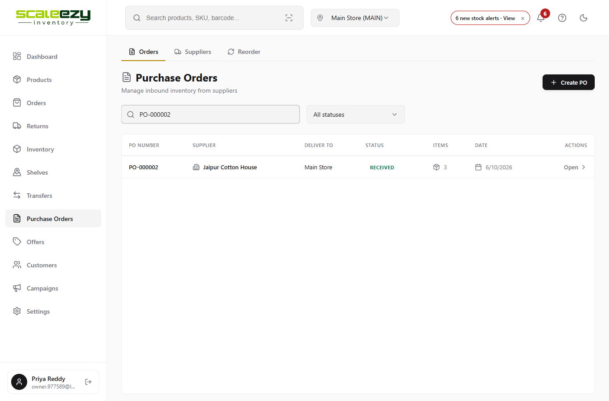
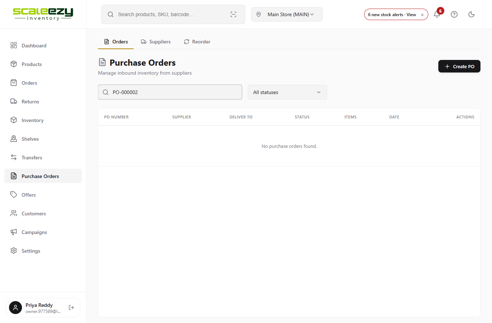
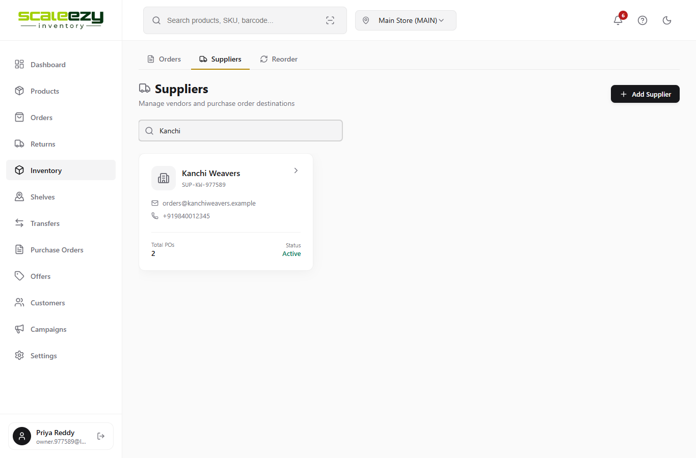
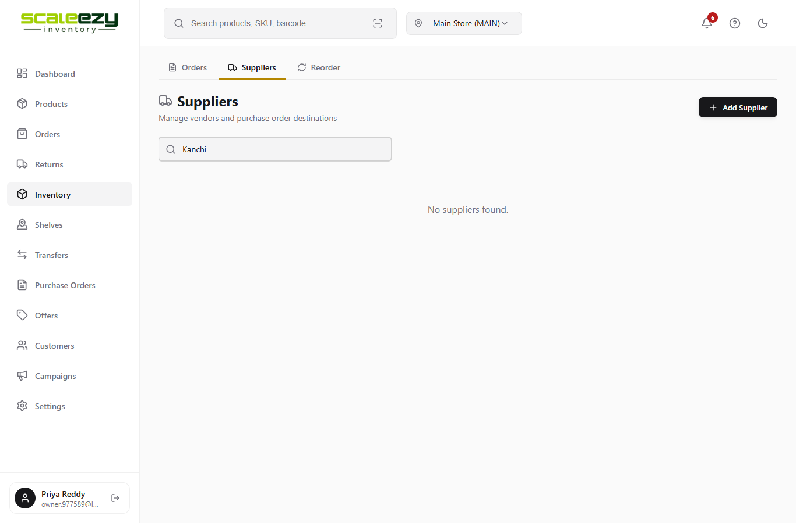
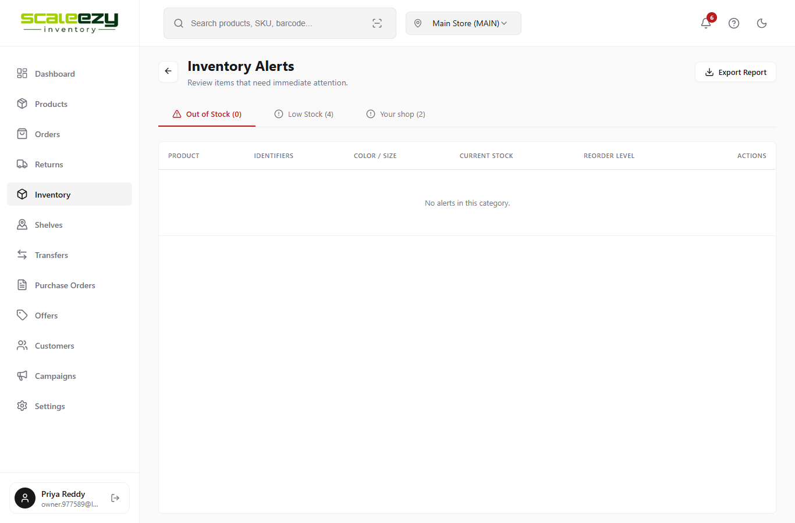
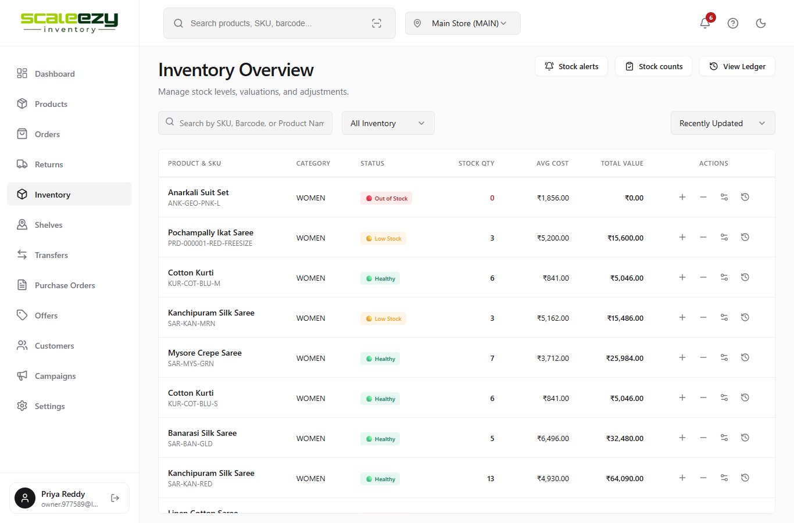
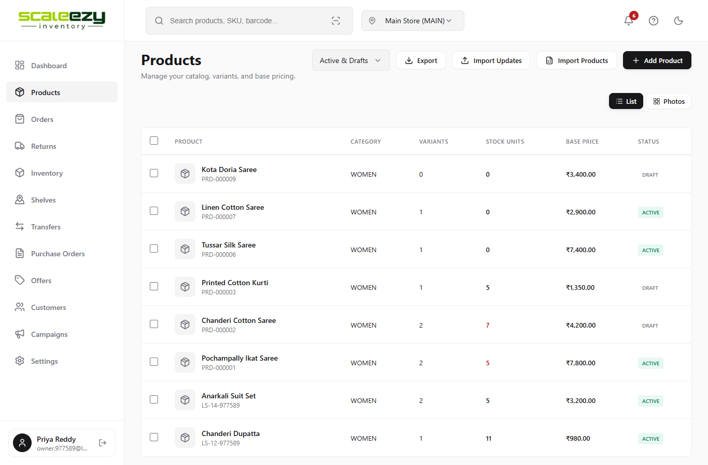
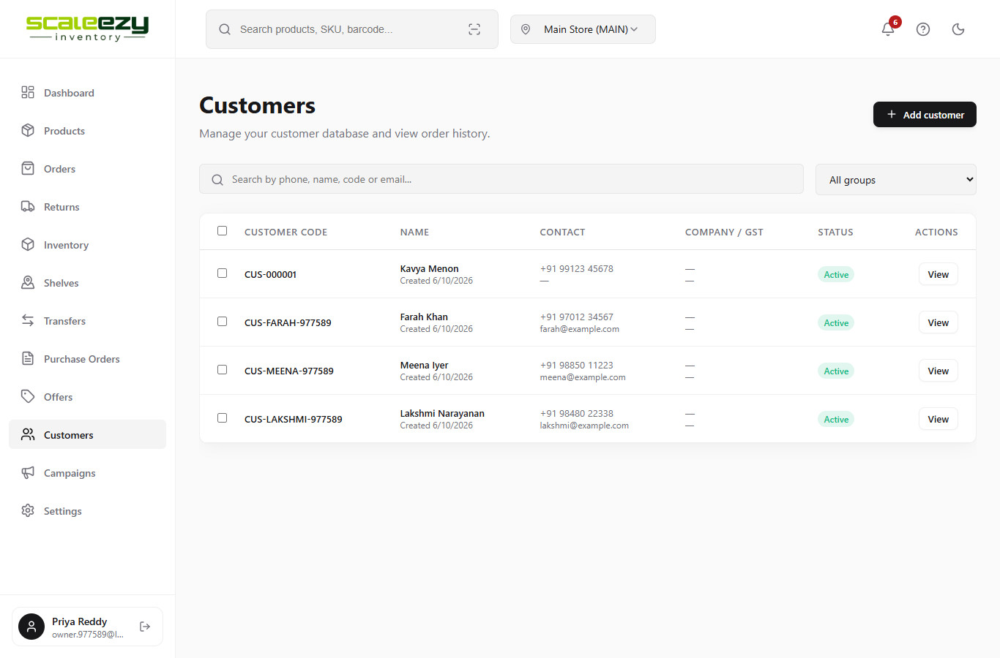
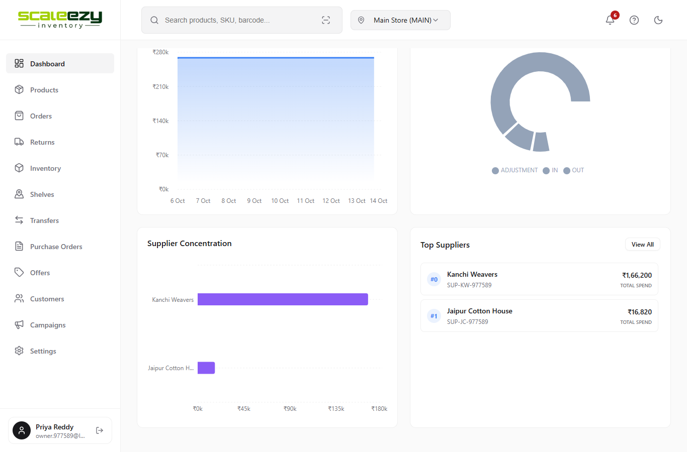

# Inventory - Bug Report

## Test Environment

| | |
|---|---|
| Application | ScaleEzy Inventory (web) |
| Branch | qa/seeded-bugs |
| URL | http://localhost:5190 |
| Test shop | Lakshmi Silks (demo), Owner login |
| Browser | Microsoft Edge, 1366 x 900 |
| Date | 15-10-2026 |

## Bug Summary

| Bug ID | Title | Module | Severity | Priority | Status |
|---|---|---|---|---|---|
| BUG-01 | PO search fails for capital letters | Purchase Orders | Minor | Medium | Open |
| BUG-02 | Supplier search does not find supplier by name | Suppliers | Minor | Medium | Open |
| BUG-03 | Out of Stock tab shows -1 | Stock Alerts | Minor | Low | Open |
| BUG-04 | Zero stock is not shown in red | Inventory | Minor | Low | Open |
| BUG-05 | Stock Units column shows variant count | Products | Major | High | Open |
| BUG-06 | Customer created date shows wrong month | Customers | Minor | Medium | Open |
| BUG-07 | Top supplier rank starts from #0 | Dashboard | Minor | Low | Open |

## BUG-01 - PO search fails for capital letters

| | |
|---|---|
| Module | Purchase Orders |
| Severity | Minor |
| Priority | Medium |
| Status | Open |
| Steps | 1. Go to Purchase Orders. 2. Type PO-000002 in the search box. |
| Expected Result | PO-000002 is shown in the list. |
| Actual Result | "No purchase orders found." Search works only in small letters (po-000002). |
| File / Line | src/pages/PurchaseOrders.jsx : 115 |
| Root Cause | Search text is not converted to lower case: (po.poNumber || '').toLowerCase().includes(searchTerm) |

Expected:

Actual:

## BUG-02 - Supplier search does not find supplier by name

| | |
|---|---|
| Module | Suppliers |
| Severity | Minor |
| Priority | Medium |
| Status | Open |
| Steps | 1. Go to Purchase Orders > Suppliers. 2. Type Kanchi in the search box. |
| Expected Result | Kanchi Weavers is shown. |
| Actual Result | "No suppliers found." Search by supplier code still works. |
| File / Line | src/pages/Suppliers.jsx : 25 |
| Root Cause | Supplier name is not converted to lower case: (s.name || '').includes(searchTerm.toLowerCase()) |

Expected:

Actual:

## BUG-03 - Out of Stock tab shows -1

| | |
|---|---|
| Module | Stock Alerts |
| Severity | Minor |
| Priority | Low |
| Status | Open |
| Steps | 1. Go to Inventory > Stock alerts. 2. Check the Out of Stock tab count. |
| Expected Result | Out of Stock (0) |
| Actual Result | Out of Stock (-1). Count is always one less than the rows. |
| File / Line | src/pages/AlertCenter.jsx : 96 |
| Root Cause | Count is shown as outOfStock.length - 1 |

Expected:

Actual:

## BUG-04 - Zero stock is not shown in red

| | |
|---|---|
| Module | Inventory |
| Severity | Minor |
| Priority | Low |
| Status | Open |
| Steps | 1. Go to Inventory. 2. Check Stock Qty of Anarkali Suit Set (Out of Stock). |
| Expected Result | 0 is shown in red. |
| Actual Result | 0 is shown in black, same as normal items. |
| File / Line | src/pages/InventoryOverview.jsx : 202 |
| Root Cause | Condition is quantity < 0. It should be quantity <= 0. |

Expected:

Actual:

## BUG-05 - Stock Units column shows variant count

| | |
|---|---|
| Module | Products |
| Severity | Major |
| Priority | High |
| Status | Open |
| Steps | 1. Go to Products. 2. Check Variants and Stock Units for Cotton Kurti. |
| Expected Result | Variants 4, Stock Units 28. |
| Actual Result | Variants 4, Stock Units 4. Out of stock items show 1 unit. |
| File / Line | src/pages/Products.jsx : 372 |
| Root Cause | Column reads variantSummary.variantCount instead of variantSummary.totalUnits. |

Expected:

Actual:

## BUG-06 - Customer created date shows wrong month

| | |
|---|---|
| Module | Customers |
| Severity | Minor |
| Priority | Medium |
| Status | Open |
| Steps | 1. Go to Customers. 2. Check the Created date under any customer (created on 6 Oct 2026). |
| Expected Result | Created 6/10/2026 |
| Actual Result | Created 6/9/2026 |
| File / Line | src/pages/sales/Customers.jsx : 186 |
| Root Cause | Date is built with getMonth(), which starts from 0. October shows as 9. |

Expected:

Actual:

## BUG-07 - Top supplier rank starts from #0

| | |
|---|---|
| Module | Dashboard |
| Severity | Minor |
| Priority | Low |
| Status | Open |
| Steps | 1. Go to Dashboard > Analytics. 2. Check the Top Suppliers card. |
| Expected Result | Kanchi Weavers #1, Jaipur Cotton House #2. |
| Actual Result | Kanchi Weavers #0, Jaipur Cotton House #1. |
| File / Line | src/components/dashboard/SupplierSpendWidget.jsx : 56 |
| Root Cause | Rank is shown as index. It should be index + 1. |

Expected:

Actual:

